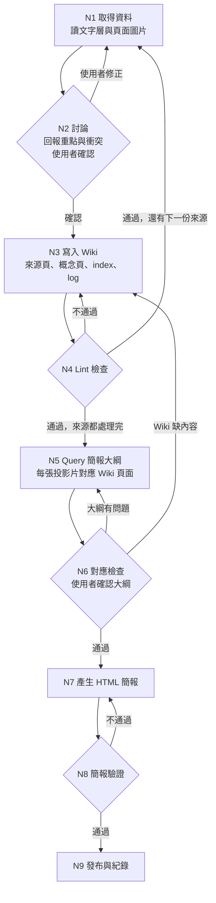

# AGENTS.md：統計學 LLM Wiki 的 schema

這份檔案告訴 LLM agent 這個 Wiki 怎麼組織、遵守哪些規範、ingest、query、lint 時要照什麼流程走
做法參考 Karpathy 的 LLM Wiki pattern：原始資料唯讀，由 LLM 寫入和維護 Wiki，schema 和使用者一起逐步修訂

## 1. 目標與範圍

- **長期目標**：把大學統計學課程（Anderson《Statistics for Business and Economics》14E）的講義和使用者的手寫筆記，整理成一份可以持續擴充的複習用知識庫
- **本輪目標**：完成「抽樣分配、中央極限定理與信賴區間」範圍的 Wiki，並以此 Wiki 為唯一知識來源，產生一份給統計初學者看的教學 HTML 簡報
- **本輪主軸問題**：只抽一次樣本，怎麼推論整個母體
- **本輪不展開的內容**：σ 未知時的 t 分配（只提一句）、比例 p̄ 的抽樣分配與區間估計、有限母體校正因子、各種抽樣方法的細節

## 2. 目錄結構

```
.
├── AGENTS.md            # 本檔，schema 本體
├── CLAUDE.md            # 引用本檔，加上 Claude Code 專用的補充
├── raw/                 # 原始資料，唯讀，不進 git
│   └── rendered/        # 由 tools/render_pages.py 產生的頁面圖片（衍生檔）
├── wiki/
│   ├── index.md         # 目錄，每頁一行摘要
│   ├── log.md           # 時間序紀錄，只能往後新增
│   ├── overview.md      # 主題總覽與概念先後關係
│   ├── sources/         # 每份來源一頁摘要
│   ├── concepts/        # 概念頁
│   └── outputs/         # query 的產出，例如簡報大綱
├── index.html           # 講義目錄，每份簡報一張卡片（GitHub Pages 首頁）
├── lessons/<slug>/      # 每份簡報一個資料夾，內含單一 index.html
└── tools/               # 讀取 PDF 用的小工具
```

## 3. 三層架構與權限

| 層 | 位置 | 誰寫 | 規則 |
|---|---|---|---|
| 原始資料 | `raw/` | 使用者 | LLM 只能讀，不能修改、改名或刪除 |
| Wiki | `wiki/` | LLM | LLM 負責全部內容，使用者閱讀和指示方向 |
| Schema | `AGENTS.md`、`CLAUDE.md` | 雙方 | 修改前先跟使用者討論，修改後記入 log |

`raw/` 有版權（講義印有 Cengage 版權聲明），因此列在 `.gitignore`，不能公開，Wiki 只放摘要、重新說明和短引用，不能整頁照抄講義

## 4. 來源清單

來源 ID 用在檔名和引用裡，`raw/` 的檔名維持原樣不改

| ID | 原始檔 | 內容 | 本輪狀態 |
|---|---|---|---|
| `ch3a` | `raw/stat chap 3a.pdf` | 描述統計：位置與變異量數 | 已 ingest |
| `ch3b` | `raw/stat chap 3b.pdf` | 分配形狀、z-score、經驗法則 | 已 ingest |
| `ch6` | `raw/stat chap 6 ppt.pdf` | 連續機率分配、常態分配 | 已 ingest |
| `ch7` | `raw/stat chap 7 ppt.pdf` | 抽樣與抽樣分配、中央極限定理 | 已 ingest |
| `ch8` | `raw/stat chap 8 ppt.pdf` | 區間估計 | 已 ingest |
| `notes` | `raw/統計筆記.pdf` | 使用者手寫筆記（全學期） | 已 ingest（p.5、6、13、14、18 到 22、24 到 27） |

其他章節（ch1、ch2a、ch2b、ch4、ch5、ch9a 到 ch14b）已放在 `raw/`，本輪不 ingest，之後擴充時再加入此表

### 來源的性質

- **講義正文**：教科書內容，是定義和公式的主要依據
- **講義上的手寫註記**：上課時的補充，要註明是手寫註記，考試範圍類的標記（例如「不考」）只是使用者對考試的註記，與內容無關，一律忽略，不寫進 Wiki，也不影響取捨
- **筆記 `notes`**：使用者自己的理解，常常更口語、更好懂，但可能有錯

來源之間說法不同時，不能默默採用其中一方，一律依第 7 節處理

## 5. 頁面規範

### 檔名與標題

- 檔名用英文 kebab-case，例如 `concepts/central-limit-theorem.md`、`sources/ch7.md`
- 頁面標題用繁體中文，第一次出現的技術名詞附英文，例如「中央極限定理（Central Limit Theorem, CLT）」

### Frontmatter

來源頁：

```yaml
---
type: source
id: ch7
raw: "raw/stat chap 7 ppt.pdf"
pages: 141
ingested: 2026-11-23
---
```

概念頁：

```yaml
---
type: concept
sources: [ch7, ch8, notes]
updated: 2026-11-23
---
```

### 來源頁的區塊

1. 一句話摘要
2. 涵蓋範圍：列出相關小節和頁碼
3. 重點：條列，每點附頁碼
4. 手寫註記：講義上的手寫補充（筆記來源則省略此區）
5. 連到的概念頁
6. 疑點：錯字、前後不一致、看不清楚的地方

### 概念頁的區塊

依序寫下列區塊，用不到的區塊省略：

1. 定義
2. 直覺解釋：給初學者看的說法
3. 公式
4. 例子：優先用講義裡的例子
5. 常見誤解
6. 相關概念：連到其他概念頁
7. 矛盾與待確認
8. 來源

### 引用

- 概念頁裡每個事實、定義、公式、數字都要附引用，格式為連到來源頁的標準 Markdown 連結加頁碼，例如 `（[ch7 p.53](../sources/ch7.md)）`
- 一個說法有多個來源支持時並列，例如 `（[ch7 p.51](../sources/ch7.md)、[notes p.20](../sources/notes.md)）`
- LLM 自己補充的說明（例如直覺解釋），如果沒有出處，要標成 `（補充說明，非來源內容）`，lint 時會特別檢查這類段落

### 連結

- 一律使用相對路徑的標準 Markdown 連結，GitHub 和 Obsidian 都能使用
- 概念頁之間要互相連結，每個概念頁至少要有一個其他頁面連進來

### 數學式

用 LaTeX：行內 `$\sigma/\sqrt{n}$`，獨立一行用 `$$ ... $$`

## 6. 寫作風格

所有 Wiki 頁面、簡報和 README 都適用：

- 繁體中文，技術名詞保留英文
- 使用台灣用語，禁止中國用語，例如寫「樣本資料」不寫「样本数据」、寫「預設」不寫「默认」、寫「程式」不寫「程序」
- 中文句子結尾不加「。」，清單項目和段落都一樣
- 不使用 emoji
- 不寫行銷式的形容詞，以初學者讀得懂為優先

## 7. 矛盾與錯誤的處理

1. 在相關概念頁的「矛盾與待確認」區塊寫下：各來源的說法、出處頁碼、LLM 的判斷和理由
2. 在 log 記一筆，標成 `[衝突]`
3. 回報使用者，由使用者決定採用哪個說法
4. 決定之後，把正文改成採用的說法，「矛盾與待確認」區塊保留紀錄，並寫上決定結果

**例外：明確的講義筆誤可以直接更正**（使用者 2026-11-23 授權），講義（不含使用者的手寫和筆記）的錯誤，如果已經看圖片確認、而且正確答案很明確（例如前後數字對不上、複製貼上沒改），可以不用先問使用者，直接在 Wiki 顯示更正後的值，並在來源頁的疑點和 log 記錄原文、更正內容和判斷依據，使用者手寫或 `notes` 的錯誤，仍然要照上面的步驟回報

案例：`notes` p.20 把 $\sigma^2/n$ 標成標準誤差，但標準誤差應為 $\sigma/\sqrt{n}$，$\sigma^2/n$ 是 $\bar{x}$ 的變異數（2026-11-23 ingest notes 時已解決，見 `wiki/concepts/standard-error.md`）

## 8. 工作流程

### 整體流程圖



### Ingest（N1 到 N4，每份來源跑一次）

1. **N1 取得資料**
   - 用 `tools/extract_text.py` 讀文字層
   - 手寫頁、圖表頁、文字層亂碼的頁面，用 `tools/render_pages.py` 轉成圖片後直接看圖，不能憑亂碼猜內容
   - `notes` 的文字層幾乎不能用，一律看圖片
   - 懷疑來源有錯誤或矛盾時，一定要先把該頁轉成圖片確認，才能回報或寫入，文字層可能把符號弄錯，例如 ch3b p.31 的文字層把 `>` 和 `<` 對調了，講義本身是正確的
2. **N2 討論**（不能跳過）
   - 生成任何 Wiki 頁面之前，先向使用者回報：3 到 5 個重點、預計新增或修改哪些頁面、發現的衝突或疑點
   - 等使用者確認或修正後才進入 N3，使用者的指示記入 log
3. **N3 寫入 Wiki**
   - 建立或更新來源頁
   - 建立或更新相關概念頁，新的說法要整合進既有內容，不是附加在最後
   - 更新 `index.md`，必要時更新 `overview.md`
   - 在 `log.md` 新增紀錄
4. **N4 Lint**：照下方 Lint 清單檢查這次改到的頁面，有問題就回到 N3 修正，修正內容也要記入 log

### Query（N5、N6）

1. 先讀 `index.md` 找相關頁面，再讀頁面內容，回答時引用 Wiki 頁面
2. 有價值的回答存進 `wiki/outputs/`，並加入 `index.md`
3. 簡報大綱存成 `wiki/outputs/slides-outline.md`，每張投影片列出：標題、教學目標、要講的重點、對應的 Wiki 頁面
4. **N6 對應檢查**：大綱裡的每個重點都要找得到對應的 Wiki 頁面和來源頁碼，找不到的話，是大綱的問題就回 N5，是 Wiki 缺內容就回 N3 補（必要時回 N1 重讀來源），大綱要經使用者確認

### 產生簡報（N7 到 N9）

1. **N7**：依確認後的大綱產生 `lessons/<slug>/index.html`，並在根目錄 `index.html` 加上一張講義卡片；架構參考 diveai-lessons（16:9 投影片、方向鍵翻頁、底部頁點），顏色和字體集中在檔案開頭的 CSS 變數，內容只能來自 Wiki，不能另外加入 Wiki 裡沒有的事實
2. **N8 簡報驗證**
   - 每張投影片的公式、數字、例子都和對應的 Wiki 頁面一致
   - 每張投影片都標出對應的 Wiki 頁面（放在頁尾或備註）
   - 初學者讀得懂：新名詞第一次出現時有解釋，概念順序沒有跳躍
   - 在瀏覽器裡實際打開，版面、數學式、互動元件都正常顯示
   - 不通過的投影片回到 N7 重新產生
3. **N9**：發布到 GitHub Pages，在 log 記錄版本和結果

### Lint 清單

可以機械檢查的項目（引用缺漏、壞連結、孤兒頁、index 遺漏、句號、emoji、中國用語）先跑 `.venv/bin/python tools/lint_wiki.py`，其餘項目要人工閱讀判斷

- [ ] 有沒有事實、公式或數字缺少引用
- [ ] 引用的頁碼對不對（抽查回到原始資料核對）
- [ ] 公式和來源一致，符號定義清楚（$\mu$、$\bar{x}$、$\sigma$、$s$、$n$、$N$）
- [ ] 頁面之間有沒有矛盾
- [ ] 寫進「疑點」或「矛盾與待確認」的每一項，都已經用頁面圖片確認過
- [ ] 有沒有孤兒頁（沒有任何頁面連進來）
- [ ] 有沒有提到了卻還沒有頁面的概念
- [ ] `index.md` 有沒有列出所有頁面
- [ ] 風格：沒有句號、沒有 emoji、使用台灣用語

## 9. Log 格式

`wiki/log.md` 只能往後新增，不能修改舊紀錄，紀錄時間一律用 `date "+%Y-%m-%d %H:%M"` 取得，不能估計，每筆的格式：

```markdown
## [2026-11-23 14:05] ingest | ch7

- 摘要：這次做了什麼
- 使用者決定：N2 討論時使用者確認或修正的內容
- 檢查：
  - [N4 lint][不通過] 發現什麼問題 → 怎麼處理
  - [N4 lint][通過]
- 異動頁面：wiki/sources/ch7.md、wiki/concepts/central-limit-theorem.md
```

- 操作類型：`discuss`、`ingest`、`query`、`lint`、`slides`、`schema`
- 檢查結果一律標上節點編號和通過與否，方便統計哪個節點最常出錯：`grep -o "\[N[0-9] [a-z]*\]\[不通過\]" wiki/log.md | sort | uniq -c`
- 來源衝突加上 `[衝突]` 標籤

## 10. Git

- commit 訊息遵守 Conventional Commits，例如 `docs(wiki): ingest ch7 sampling distributions`
- Wiki 內容用 `docs(wiki): ...`，簡報用 `feat(slides): ...`，schema 用 `docs(schema): ...`，README 用 `docs(readme): ...`
- 一次 ingest 一個 commit
