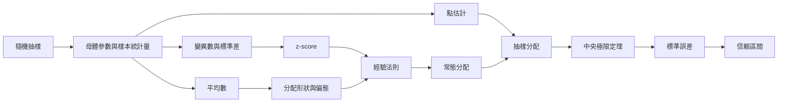

# 總覽：只抽一次樣本，怎麼推論整個母體

本輪主題是抽樣分配、中央極限定理與信賴區間，這頁整理概念之間的先後關係，隨 ingest 逐步補完

## 概念鏈

| 步驟 | 概念 | 回答的問題 | 頁面 |
|---|---|---|---|
| 0 | 隨機抽樣 | 樣本要怎麼抽才能代表母體 | [random-sampling](concepts/random-sampling.md) |
| 1 | 母體參數與樣本統計量 | 我們想知道什麼，手上又有什麼 | [parameter-and-statistic](concepts/parameter-and-statistic.md)、[point-estimation](concepts/point-estimation.md) |
| 2 | 平均數 | 資料的中心在哪裡 | [mean](concepts/mean.md) |
| 3 | 變異數與標準差 | 資料有多分散 | [variance-and-standard-deviation](concepts/variance-and-standard-deviation.md) |
| 4 | 分配形狀與偏態 | 分配是對稱還是有一邊拖著長尾巴 | [distribution-shape](concepts/distribution-shape.md) |
| 5 | z-score | 一筆資料離平均數幾個標準差 | [z-score](concepts/z-score.md) |
| 6 | 經驗法則 | 鐘形分配下，平均數附近有多少資料 | [empirical-rule](concepts/empirical-rule.md) |
| 7 | 常態分配 | 最重要的分配長什麼樣子，機率怎麼查 | [normal-distribution](concepts/normal-distribution.md)、[standard-normal](concepts/standard-normal.md) |
| 8 | 抽樣分配 | 每次抽樣算出的 $\bar{x}$ 都不一樣，它們怎麼分布 | [sampling-distribution](concepts/sampling-distribution.md) |
| 9 | 中央極限定理 | 不管母體長怎樣，$\bar{x}$ 為什麼會接近常態 | [central-limit-theorem](concepts/central-limit-theorem.md) |
| 10 | 標準誤差 | $\bar{x}$ 離 $\mu$ 通常差多少，樣本越大差越少 | [standard-error](concepts/standard-error.md) |
| 11 | 信賴區間 | 只抽一次樣本，怎麼說出 μ 大概在哪個範圍 | [confidence-interval](concepts/confidence-interval.md)、[margin-of-error](concepts/margin-of-error.md) |

符號請查 [符號對照表](concepts/notation.md)
